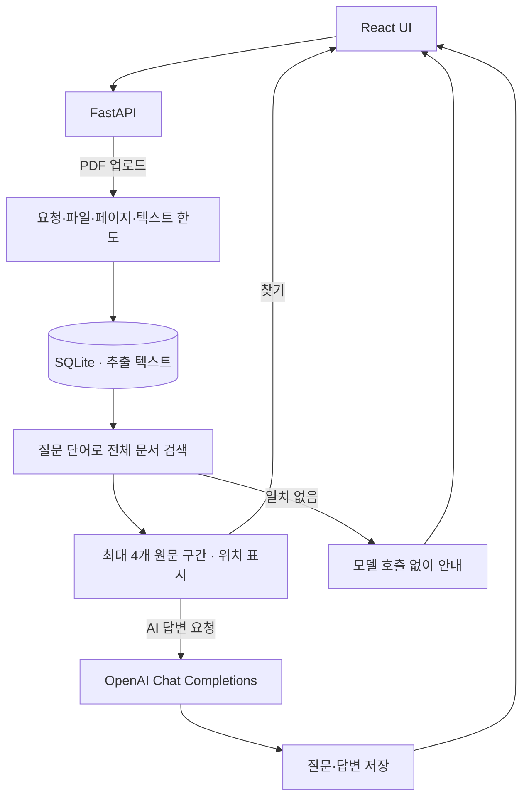

# DocInsight AI

PDF 전체에서 질문과 관련된 구간을 찾고, 그 구간을 OpenAI에 전달해 답변을 생성하는 FastAPI·React 애플리케이션입니다. 검색한 원문을 화면에서 직접 확인할 수 있습니다.

**2026-11-01 개선:** 질문에 문서 앞 12,000자만 전달하던 흐름을 전체 텍스트의 lexical retrieval로 변경했습니다. 업로드·검색은 API 키 없이 실행되며, AI 답변·요약에만 키가 필요합니다. [구현과 검증 기록](docs/DOCUMENT_EVIDENCE_20261101.md)

## 처리 흐름



- **검색:** 1,200자 청크, 200자 overlap, 질문 단어의 빈도·희소성으로 순위를 매깁니다. 선택된 구간은 서로 겹치지 않으며 최대 4개입니다. 한국어 조사 일부와 대소문자를 검색용으로 정규화하되 반환 원문은 바꾸지 않습니다.
- **근거 표시:** `source_id`, `start_char`, `end_char`, 원문을 반환합니다. 위치는 추출 텍스트의 Python Unicode 문자 인덱스이며 끝 위치는 제외됩니다. PDF 쪽수나 JavaScript UTF-16 인덱스가 아닙니다.
- **답변:** 검색된 문맥만 모델에 제공하고 구간 식별자를 요청합니다. 반환 구간은 모델에 제공한 문맥이며, 생성된 답변의 사실성·인용 일치를 자동 검증했다는 뜻은 아닙니다.
- **검색 결과 없음:** 모델을 호출하지 않고 문서에 쓰인 단어로 다시 질문하도록 안내합니다. 어휘 불일치일 수 있으므로 문서에 답이 없다고 단정하지 않습니다.
- **요약:** 기존 요약 재사용. 현재도 **앞 12,000자만** 요약하며 UI와 응답 metadata에 범위를 표시합니다.
- **업로드:** 요청 본문을 multipart 파싱 전에 제한하고, UUID 파일명·실제 파일 바이트·유효 PDF·페이지 수·추출 문자 수를 검사합니다. 실패 시 파일과 DB 작업을 정리합니다.
- **외부 API:** 요청당 SDK 재시도 0회, timeout 설정 30초, 출력 한도 1,000 tokens. 키 누락 503, timeout 504, 외부 오류·불완전 응답 502. 실패한 답변은 이력에 저장하지 않습니다. SDK timeout은 전체 작업의 절대 실행 시간 보장은 아닙니다.

벡터 DB, embeddings, OCR, 모델 학습·파인튜닝은 사용하지 않습니다. lexical retrieval을 포함한 API 통합 프로젝트입니다.

## 로컬 실행

Python 3.12, Node.js 22 기준입니다. 인증이 없는 개인 로컬 앱이므로 기본 loopback 주소로 실행합니다.

```bash
python3 -m venv .venv
source .venv/bin/activate
pip install -r requirements.txt
cp .env.example .env
uvicorn app.main:app --host 127.0.0.1 --port 8000
```

별도 터미널:

```bash
cd frontend
npm ci
npm run dev -- --host 127.0.0.1 --port 5173
```

브라우저 `http://127.0.0.1:5173`, API 명세 `http://127.0.0.1:8000/docs`.

키가 빈 상태로 PDF 업로드 → 문서 선택 → 구체적인 질문 입력 → **문서에서 찾기**를 사용할 수 있습니다. **AI로 답변 받기**와 요약은 `.env`에 유효한 `OPENAI_API_KEY`를 설정한 뒤 서버를 다시 실행합니다. 해당 기능은 문서 내용을 외부 API에 전달하며 비용이 발생할 수 있습니다. 기존 기본 모델 `gpt-4.1-mini`를 유지했고 실제 계정의 모델 접근 가능 여부는 별도 확인이 필요합니다.

| 설정 | 기본값 |
|---|---|
| `OPENAI_API_KEY` | 빈 값 — 업로드·검색 사용 가능 |
| `MODEL_NAME` | `gpt-4.1-mini` |
| `DATABASE_URL` | `sqlite:///./docinsight.db` |
| `UPLOAD_DIR` | `uploads` |
| `MAX_UPLOAD_BYTES` | 10 MiB |
| `MAX_PDF_PAGES` | 200 |
| `MAX_DOCUMENT_CHARS` | 1,000,000 |

요청 전체 한도는 파일 한도 + multipart 여유 64 KiB입니다. 프런트엔드 API 주소는 기본 `http://127.0.0.1:8000`, 필요하면 `VITE_API_BASE_URL`로 바꿉니다. CORS 허용 origin은 localhost/127.0.0.1의 5173 포트이며 인증 기능은 아닙니다. 기본값을 바꾸면 UI의 한도 안내도 함께 조정해야 합니다.

DB와 업로드 파일은 실행 시 생성하며 Git에서 제외합니다. 과거 commit에 있던 DB를 지우는 history rewrite는 하지 않습니다.

## 검증

```bash
python -m unittest discover -s tests -v
cd frontend
npm run lint
npm run build
```

2026-11-01 로컬: **34개 백엔드 테스트 통과**, React 린트·빌드 통과. 테스트는 임시 파일·인메모리 DB·가짜 AI 응답을 사용하며 실제 모델을 호출하지 않습니다. 브라우저 확인과 상세 범위는 [검증 기록](docs/DOCUMENT_EVIDENCE_20261101.md)에 기록합니다. GitHub Actions에서 동일한 백엔드·프런트엔드 검증을 실행합니다.

## API

| Method | Path | 동작 |
|---|---|---|
| POST | `/documents/upload` | PDF 검사·추출·저장 |
| GET | `/documents` | 목록 |
| GET | `/documents/{id}` | 상세 |
| POST | `/documents/{id}/search` | 전체 문서에서 원문 구간 검색, 모델 호출 없음 |
| POST | `/documents/{id}/ask` | 검색 후 AI 답변 또는 일치 없음 안내, 이력 저장 |
| POST | `/documents/{id}/summarize` | 앞부분 요약 또는 캐시 반환 |
| GET | `/documents/{id}/questions` | 질문·답변 이력 |

`search`/`ask` body: `{"question":"계약 해지 통보 기간은?"}`. 질문은 공백 제거 후 1–1,000자. `ask`는 `sources`와 `answer_status`(`generated`/`no_evidence`)도 반환합니다. 요약은 `source_chars`, `total_chars`, `truncated`를 반환합니다.

## 한계와 다음 작업

- 어휘 기반 검색은 동의어·간접 질문·잘린 문장을 놓칠 수 있습니다. 합성 회귀 테스트 통과는 실제 문서 검색 정확도나 AI 답변 품질 점수가 아닙니다.
- OCR, PDF 쪽수 연결, 이력의 검색 구간 영속화, 삭제 API, 질문 이력 UI는 없습니다.
- 요약은 전체 문서 요약이 아닙니다. 모델 응답의 출처 일치도 프로그램으로 보장하지 않습니다.
- 인증·사용자별 격리·작업 큐·동시 요청 quota는 없습니다. 공개 서비스로 배포하기 전 별도 설계가 필요합니다.
- 업로드 예산은 PDF 파서의 CPU/메모리 sandbox가 아닙니다. 한 페이지의 압축 해제와 텍스트 추출은 문자 한도 검사 전에 발생합니다. 이전 DB의 대형 문서에는 새 업로드 제한이 소급되지 않습니다.
- 호환 가능한 npm 패치 적용 후 감사 결과에 ESLint/minimatch 계열 개발 의존성 moderate 6개가 남았습니다. 강제 major override 없이 기록했고 관련 upstream 업데이트가 필요합니다.

변경 이력은 [CHANGELOG](CHANGELOG.md)에 있습니다. 별도 라이선스 파일은 없습니다.
